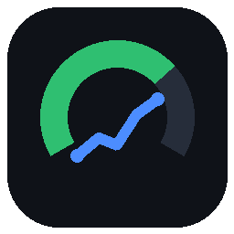

# Prédiction RL

[Français](README.md) · **English**

**Your chance to win, live, in Rocket League.** Free, no account, no ads.

When each match kicks off, Prédiction RL reads who is in the match, fetches their stats from tracker.gg and
computes your chance of winning. During the match, the probability moves with the score and the clock, shown on top
of the game. At the end, the result is recorded automatically and the model learns from your games.

> Unofficial fan project, **not affiliated with Psyonix, Epic Games or Tracker Network**. It uses the game's
> official [Stats API](https://www.rocketleague.com/developer/stats-api): nothing is injected into Rocket League,
> no risk for your account.

## Install

1. Download `PredictionRL-Setup-x.y.z.exe` from the [Releases](../../releases/latest).
2. Run it. Windows may show **"Windows protected your PC"**: the app isn't code-signed (a certificate costs money,
   like for many free tools, BakkesMod included). Click **More info → Run anyway**. Every version is built automatically by GitHub
   and published with its SHA-256 checksum (`.sha256`, next to the installer) so you can verify your download.
3. That's it. Like BakkesMod, **launch Prédiction RL before playing** (desktop shortcut or Start menu): its icon
   appears next to the clock, it waits for Rocket League in the background and updates itself (when the game is
   closed). It can also start with Windows (right-click the icon).

On first launch it enables the game's Stats API (if Rocket League was already open, restart it once) and downloads
an invisible Chromium browser (~150 MB) used to read tracker.gg.

## How to use

Launch Prédiction RL, then a match: nothing else to do.

| | |
|---|---|
| **Icon next to the clock** | click: menu; right-click: web page, start with Windows, help, copy diagnostics, quit. The tooltip shows whether the game is detected. Windows 11 first hides it under the "^" arrow: drag it to the taskbar to keep it visible |
| **Overlay** | live probability, score, pre-match probability and curve, top left during matches |
| **F2** (F3 if BakkesMod is installed) | menu: match details (players, ranks, MMR, why), settings, models, updates, language |
| **Ctrl+Shift+O** | hide / show the overlay |

**Display mode**: the overlay and the menu show in **windowed** or **borderless** mode. In *exclusive* fullscreen,
Windows doesn't let any window show on top of the game: use the Steam overlay instead
(**Shift+Tab** → web browser → `127.0.0.1:8765/overlay` → pin the window), which shows in game.

Only **ranked** games (1v1, 2v2, 3v3) are recorded and used for training; casual games are predicted for info only.
**My stats** (menu): win rate, streaks, MMR history, prediction accuracy, frequent teammates.

## How reliable is it?

Honestly:

- **Before the match**, the factor that really matters is the **MMR difference**. Each time it trains, the model
  checks whether other factors (recent form, peak, fatigue, time of day…) help on games it has never seen, and uses
  them only if they do. It takes a few dozen ranked games per mode.
- **During the match**, the live probability (score + time left) is clearly more accurate than the pre-match one.
- Rocket League is very random: at 70%, you still lose 3 times out of 10.

## Privacy

Everything stays on your PC (`%APPDATA%\PredictionRL`): history, model, settings. Nothing is sent anywhere except
requests to tracker.gg (public stats of the players in your match) and to GitHub (update check). No account, no
telemetry.

## Common issues

- **Nothing shows up**: are you in exclusive fullscreen? (see *Display mode*). Otherwise, check the log:
  `%APPDATA%\PredictionRL\journal.log`.
- **"Rocket League not detected"** after a game update: the app re-enables the Stats API on its own; restart
  Rocket League.
- **Prediction failed**: tracker.gg may be slow or temporarily blocking; the live probability still works.
- **Report a problem**: right-click the icon → "Copy diagnostics", then open an
  [issue](../../issues/new/choose) and paste it.
- **Uninstall**: Windows Settings → Apps → Prédiction RL. Your data stays in `%APPDATA%\PredictionRL` (delete the
  folder to erase everything).

## License

Free, see [LICENSE](LICENSE). "Rocket League" is a trademark of Psyonix LLC.
